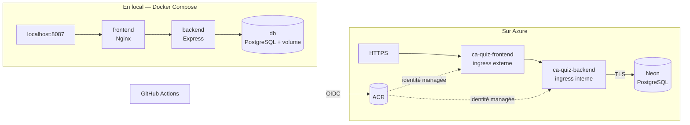

# Quiz App — conteneurisation, sécurité et déploiement sur Azure

[](https://github.com/Stephane-Dedu/eval-quiz-app/actions/workflows/ci.yml)
[](https://github.com/Stephane-Dedu/eval-quiz-app/actions/workflows/cd.yml)

Évaluation du cours Conteneurs : l'application de quiz fournie est conteneurisée, sécurisée, orchestrée avec Docker Compose, déployée sur Azure Container Apps avec Azure CLI, puis livrée automatiquement par GitHub Actions. Le code applicatif n'est pas modifié ([ADR 0002](docs/adr/0002-code-applicatif-fige.md)).

Le sujet du formateur est dans [`docs/00-sujet.md`](docs/00-sujet.md) et [`docs/01`](docs/01-presentation-projet.md) à [`docs/09`](docs/09-utilisation-ia.md).

## Architecture



Détail : [architecture locale](docs/technique/analyse-j1.md#6-architecture-locale), [architecture Azure](docs/technique/azure.md#architecture).

## Lancer en local

Prérequis : Docker avec Compose v2.

```console
$ cp .env.example .env
$ docker compose up -d --build --wait
$ ./scripts/smoke-test.sh
```

L'application est sur http://localhost:8087 et l'administration sur http://localhost:8087/gestion-quiz. `docker compose down` arrête tout en gardant les données ; `docker compose down -v` les efface. Détails : [conteneurisation](docs/technique/conteneurisation.md).

## Déployer sur Azure

Prérequis : Azure CLI connecté (`az login`), Docker avec buildx, `jq`, `openssl`, et `trivy` pour scanner avant publication.

```console
$ export ADMIN_PASSWORD='…' JWT_SECRET="$(openssl rand -hex 32)"
$ export DATABASE_URL='postgresql://…?sslmode=verify-full'   # base Neon
$ ./scripts/deploy.sh
```

Le script est rejouable : une seconde exécution ne recrée rien. Il affiche à la fin l'URL de l'application.

**Nettoyage.** `./scripts/destroy.sh` supprime toutes les ressources après confirmation. Le sujet demande de ne le faire qu'après avoir sauvegardé les preuves et obtenu l'accord du formateur.

Détails : [déploiement Azure](docs/technique/azure.md).

## Livraison continue

1. Une modification part d'une branche `feature/*` et arrive sur `main` par une Pull Request.
2. La CI construit les trois images, les scanne avec Trivy, rejoue les lints et lance le test d'intégration. Toute vulnérabilité CRITICAL bloque la fusion, y compris pour l'administrateur.
3. Après la fusion, le CD reconstruit et rescanne les images, attend une approbation sur l'environnement `production`, publie dans Azure Container Registry, puis crée une nouvelle révision des deux Container Apps.

Détails : [CI/CD](docs/technique/ci-cd.md).

## Jalons et preuves

| Jalon | Contenu | Preuves |
| --- | --- | --- |
| J0 | Accès à l'abonnement Azure | [`preuves/J0`](preuves/J0/) |
| J1 | Conteneurisation locale, persistance, réseau | [`preuves/J1`](preuves/J1/), [analyse](docs/technique/analyse-j1.md) |
| J2 | Scans Trivy avant/après, corrections | [`preuves/J2`](preuves/J2/) |
| J3 | Ressources Azure créées par Azure CLI, images dans ACR | [`preuves/J3`](preuves/J3/) |
| J4 | Container Apps, ingress, révisions, `/health` | [`preuves/J4`](preuves/J4/) |
| J5 | PostgreSQL Neon chiffré, persistance | [`preuves/J5`](preuves/J5/) |
| J6 | Contrôles avant fusion, déploiement après fusion | [`preuves/J6`](preuves/J6/) |
| Bonus | Mise à l'échelle automatique sous charge | [`preuves/bonus`](preuves/bonus/) |

Pull Requests : [toutes](https://github.com/Stephane-Dedu/eval-quiz-app/pulls?q=is%3Apr). Exécutions : [CI](https://github.com/Stephane-Dedu/eval-quiz-app/actions/workflows/ci.yml), [CD](https://github.com/Stephane-Dedu/eval-quiz-app/actions/workflows/cd.yml).

## Documentation

| Document | Contenu |
| --- | --- |
| [Documentation technique](docs/technique/README.md) | Index, feuille de route, conventions |
| [Listes de contrôle](docs/technique/checklists.md) | Critères vérifiables par volet |
| [Problèmes connus](docs/technique/problemes-connus.md) | Défauts du code fourni et leur traitement |
| [Décisions d'architecture](docs/adr/) | Choix structurants et leurs raisons |
| [Vocabulaire](GLOSSARY.md) | Termes du domaine |
| [Support de soutenance](docs/soutenance/soutenance.pdf) | 6 diapositives, avec notes de présentation dans le [.pptx](docs/soutenance/soutenance.pptx) |

## Usage de l'IA

- **Outil :** Claude Code (Anthropic), assistant en ligne de commande.
- **Tâches assistées :**
  - relecture du code fourni et repérage de ses défauts ;
  - premières versions des Dockerfiles, du fichier Compose, des scripts Azure CLI et des workflows ;
  - recherche dans la documentation Azure (mode Express des environnements Container Apps, quotas Azure for Students) ;
  - rédaction de la documentation.
- **Vérification des propositions :**
  - chaque fichier est passé par les outils de contrôle : hadolint, shellcheck, actionlint, `docker compose config`, Trivy ;
  - tout a été exécuté réellement : builds, test d'intégration, parcours navigateur automatisé, déploiements Azure, passages de CI et de CD ;
  - les écarts constatés ont été diagnostiqués et corrigés à partir des journaux. Exemples : le cache invalidé par `ARG REVISION`, l'environnement Express qui empêchait le frontend de joindre le backend, l'adresse client faussée par les proxys.
- **Secrets :** aucun secret réel n'est communiqué à l'assistant. Ils sont générés et conservés localement, puis lus depuis l'environnement par les scripts.
