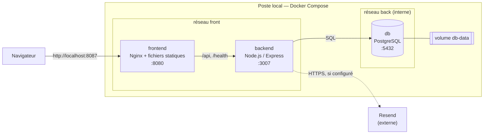

# Analyse préalable — Jalon 1

Analyse demandée par `docs/08-documentation-technique.md` §8, rédigée avant d'écrire les fichiers de conteneurisation. Sources lues : `backend/server.js`, `main.js`, `public/admin.js`, `vite.config.js`, `nginx/nginx.conf`, `database/init.sql`, les deux `package.json`.

Les points marqués « à vérifier » sont des déductions de lecture ; ils sont confirmés ou corrigés par des tests dans `preuves/J1/`.

## 1. Composants, rôles et dépendances

| Composant | Rôle | Dépend de |
| --- | --- | --- |
| Frontend | Deux pages construites par Vite en fichiers statiques : `index.html` (quiz) et `gestion-quiz.html` (administration) | Le backend, appelé par des URL relatives (`/api`, `/api/admin`) |
| Nginx | Sert les fichiers statiques et relaie `/api/` et `/health` vers le backend | Le backend, résolu sous le nom `backend` au démarrage de Nginx |
| Backend | API Express : inscription d'un **Participant**, enregistrement d'un **Résultat**, email, administration | PostgreSQL (`DATABASE_URL`) et Resend (`RESEND_API_KEY`) |
| PostgreSQL | Stocke les **Participants**, les **Résultats** et les **Réponses** | Un volume persistant |
| Resend | Envoie l'email de **Résultat** | Service externe, clé d'API |

Conséquences pour la conteneurisation :

- **Le frontend n'a aucune URL de backend à configurer.** Tous ses appels sont relatifs, donc il doit être servi par un serveur qui relaie `/api` vers le backend sur la même origine. Nginx et les fichiers statiques vont dans la même image : l'image frontend.
- **Le backend refuse de démarrer sans `RESEND_API_KEY`** (vérifié). Le SDK Resend lève une erreur dès l'import si la clé est absente. Une valeur factice suffit quand l'email n'est pas configuré.
- **Le backend n'a pas besoin de la base pour démarrer** (vérifié). Le pool `pg` ne se connecte qu'à la première requête, et `/health` n'interroge pas la base. `/health` répond donc 200 même base arrêtée : il prouve que le processus vit, pas que l'application fonctionne.

Les deux points sont démontrés dans [`preuves/J1/diagnostic-demarrage-backend.md`](../../preuves/J1/diagnostic-demarrage-backend.md).

## 2. Ports

| Port | Usage | Exposé en local | Sur Azure |
| --- | --- | --- | --- |
| 5173 | Serveur de développement Vite (`npm run dev`) | Non, inutile en conteneur | Non |
| 8087 → 8080 | Nginx dans l'image frontend | **Oui, seul port publié** sur l'hôte | Ingress externe HTTPS 443 → 8080 |
| 3007 | API Express | Non, réseau interne uniquement | Ingress interne uniquement |
| 5432 | PostgreSQL | Non, réseau interne uniquement | Remplacé par Neon (TLS) |

Nginx écoute sur 8080 et non 80 parce qu'il tourne en utilisateur non-root, qui ne peut pas ouvrir un port inférieur à 1024. Le port d'accès local reste 8087, comme dans la solution d'origine.

## 3. Configuration : paramètres publics et secrets

| Variable | Utilisée par | Nature | Valeur par défaut dans le code | Remarque |
| --- | --- | --- | --- | --- |
| `PORT` | backend | public | `3007` | |
| `POSTGRES_DB` | PostgreSQL | public | — | |
| `POSTGRES_USER` | PostgreSQL | public | — | |
| `POSTGRES_PASSWORD` | PostgreSQL | **secret** | — | |
| `DATABASE_URL` | backend | **secret** | aucune | Contient le mot de passe ; sur Neon, impose TLS |
| `RESEND_API_KEY` | backend | **secret** | aucune | Obligatoire au démarrage |
| `FROM_EMAIL` | backend | public | `Quiz App <noreply@notifications.labformation.fr>` | Facultative |
| `ADMIN_USERNAME` | backend | public | `admin` | |
| `ADMIN_PASSWORD` | backend | **secret** | `admin123` | Défaut faible : toujours fournir une valeur |
| `JWT_SECRET` | backend | **secret** | `change-this-secret` | Défaut connu : sans valeur, n'importe qui peut forger un jeton administrateur |

Les secrets ne sont jamais dans le dépôt : `.env` local (ignoré par git) et secrets Container Apps sur Azure.

## 4. Routes de santé et d'intégration

| Route | Usage | Réponse attendue |
| --- | --- | --- |
| `GET /health` | Santé du processus | `200 {"status":"ok"}`, sans accès à la base |
| `POST /api/users` | Inscrire un **Participant** | `201` avec `{id, firstname, email}` |
| `POST /api/results` | Enregistrer un **Résultat** et ses **Réponses** | `201` |
| `POST /api/admin/login` | Obtenir un jeton administrateur | `200 {token}` |
| `GET /api/admin/results` | Lister les **Résultats** (jeton requis) | `200` avec la liste paginée |

Le test d'intégration enchaîne : santé → inscription → **Résultat** → connexion administrateur → le **Résultat** apparaît dans la liste. Il prouve que les quatre composants communiquent, ce que `/health` seul ne prouve pas.

Deux limites du code influencent ces tests :

- **Limiteurs de débit.** Toutes les routes, `/health` compris, partagent un limiteur de 100 requêtes par 15 minutes et par IP ; l'inscription est limitée à 5 et les **Résultats** à 10. Une sonde Azure qui appelle `/health` toutes les quelques secondes finit refusée (429) : les sondes vérifient donc le port TCP.
- **Champ piège.** Si le champ `website` est rempli, l'inscription renvoie un faux `201` sans rien écrire. Le test le laisse vide.

## 5. Où vivent les Questions et les Résultats

- **Les Questions sont dans le code du frontend**, un fichier par **Sujet** (`questions_<sujet>.js`), regroupés par Vite en un fichier JavaScript par **Sujet**. Elles ne sont pas en base. Modifier une **Question** ne demande donc que de reconstruire et redéployer l'image frontend.
- **Les Résultats sont en base**, dans trois tables définies par `database/init.sql` :
  - `users` : une ligne par inscription ;
  - `quiz_results` : un **Résultat** par ligne, avec score et nombre de **Questions** ;
  - `answers` : une **Réponse** par ligne.
- **Le score est calculé dans le navigateur** et accepté tel quel par le backend.
- **`init.sql` n'est pas rejouable** : il crée les tables sans `IF NOT EXISTS`.

## 6. Architecture locale

Le backend est le seul service branché sur les deux réseaux. Le frontend ne peut donc pas joindre la base, et la base n'a aucun port publié sur l'hôte.

## 7. Choix de conteneurisation et de persistance

- **Trois conteneurs**, un par responsabilité : frontend (Nginx et fichiers statiques), backend, base. Nginx n'a pas de conteneur à part : il ne sert qu'à livrer les fichiers du frontend et à relayer l'API, donc il fait partie de l'image frontend.
- **Images multi-étapes** : on construit avec Node, puis on n'embarque à l'exécution que le nécessaire (fichiers statiques pour le frontend, dépendances de production pour le backend).
- **PostgreSQL part de l'image officielle**, dérivée dans `database/Dockerfile` pour embarquer `init.sql` dans `/docker-entrypoint-initdb.d/`. L'image officielle n'exécute ce dossier que si le volume est vide, ce qui correspond exactement à un script non rejouable. L'image dérivée démarre aussi en utilisateur `postgres` et retire `gosu`, devenu inutile (voir `preuves/J2/`).
- **Persistance par un volume nommé** monté sur le répertoire de données de PostgreSQL. Recréer les conteneurs (`docker compose down` puis `up`, sans `-v`) conserve les données ; seul `docker compose down -v` les efface.
- **Ordre de démarrage par contrôles de santé** : le backend attend que la base accepte les connexions, et le frontend attend le backend. Nginx a besoin de résoudre `backend` à son démarrage.
