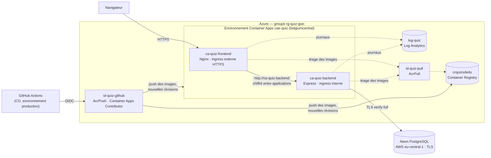

# Déploiement sur Azure Container Apps

Volets **Azure** et **CI/CD** (partie déploiement). Les preuves sont dans [`preuves/J3/`](../../preuves/J3/), [`preuves/J4/`](../../preuves/J4/), [`preuves/J5/`](../../preuves/J5/) et [`preuves/J6/`](../../preuves/J6/). Les choix structurants sont dans les ADR [0001](../adr/0001-azure-cli-deploie-terraform-en-vitrine.md), [0003](../adr/0003-secrets-container-apps-plutot-que-key-vault.md) et [0004](../adr/0004-cd-sans-secret-applicatif.md).

## Architecture



## Ressources

| Ressource | Nom | Réglage | Pourquoi |
| --- | --- | --- | --- |
| Groupe de ressources | `rg-quiz-gwc` | `germanywestcentral` (groupe, registre, identités, journaux) | Une des 5 régions autorisées par l'abonnement Azure for Students, dans la même ville que la base Neon (Francfort) |
| Budget | `budget-quiz` | 10 par mois, alertes à 50, 80 et 100 % | Un oubli ne consomme pas le crédit étudiant en silence |
| Log Analytics | `log-quiz` | Rétention 30 jours | Journaux des conteneurs consultables après coup ; 30 jours est le minimum, inclus sans surcoût |
| Container Registry | `crquizsdedu` | SKU Basic, compte administrateur désactivé | Moins cher ; aucun mot de passe partagé, l'accès passe par des identités |
| Identité de tirage | `id-quiz-pull` | `AcrPull` sur le registre | Les applications ne peuvent que lire les images |
| Identité du CD | `id-quiz-github` | `AcrPush` sur le registre, `Container Apps Contributor` sur le groupe, `Managed Identity Operator` sur `id-quiz-pull` | Publier des images et créer des révisions, rien d'autre ; le dernier rôle est exigé par Azure pour mettre à jour une application qui utilise `id-quiz-pull` |
| Environnement | `cae-quiz` | `belgiumcentral`, mode WorkloadProfiles (profil Consommation), chiffrement entre applications, journaux vers `log-quiz` | Facturation à l'usage, zéro réplica possible ; découverte de services interne (voir [ADR 0005](../adr/0005-environnement-workload-profiles.md)) |
| Application backend | `ca-quiz-backend` | 0,25 vCPU, 0,5 Gio, ingress **interne** sur 3007 | Injoignable depuis Internet |
| Application frontend | `ca-quiz-frontend` | 0,25 vCPU, 0,5 Gio, ingress **externe** HTTPS sur 8080 | Seule porte d'entrée ; HTTP redirigé vers HTTPS |

## Réseau

- **Une seule entrée publique.** Le frontend a un ingress externe ; le backend un ingress interne, joignable seulement depuis l'environnement.
- **Frontend → backend par le nom d'application.** Nginx appelle `http://ca-quiz-backend`, que la découverte de services de l'environnement résout. Le chiffrement du trafic entre applications, activé sur l'environnement, protège ce trajet sans certificat à gérer dans Nginx. Le même modèle Nginx sert en local avec `http://backend:3007` : seule la variable `BACKEND_ORIGIN` change.
- **Pourquoi pas le mode Express.** `az containerapp env create` crée par défaut un environnement Express. Ce mode n'a pas de découverte de services : un backend à ingress interne y est injoignable pour le frontend, qui n'obtient que la réponse 404 du proxy public. Il n'a pas non plus de domaine personnalisé. L'environnement est donc créé par l'API REST en mode WorkloadProfiles ([ADR 0005](../adr/0005-environnement-workload-profiles.md)).
- **Adresse réelle du client.**
  - Le problème : une requête traverse le proxy public de Container Apps, puis Nginx, puis le proxy interne, avant d'atteindre le backend. Le backend, réglé pour croire deux proxys (`trust proxy 2`), aurait pris l'adresse du proxy public pour celle du client. Tous les visiteurs auraient alors partagé le même compteur de limitation de débit : 5 inscriptions par quart d'heure pour tout le monde.
  - Le correctif, sans toucher au code : Nginx retrouve l'adresse ajoutée par le proxy public (module `real_ip`, `TRUSTED_PROXY_CIDR=0.0.0.0/0`, sûr puisque tout le trafic entrant passe par ce proxy) et ne transmet qu'elle au backend.

## Secrets et configuration

| Valeur | Où elle vit | Comment elle y arrive |
| --- | --- | --- |
| `DATABASE_URL`, `JWT_SECRET`, `ADMIN_PASSWORD`, `RESEND_API_KEY` | Secrets de `ca-quiz-backend`, exposés en variables par `secretref:` | `deploy.sh`, depuis l'environnement de l'opérateur |
| `ADMIN_USERNAME`, `FROM_EMAIL` | Variables du backend | `deploy.sh` |
| `BACKEND_ORIGIN`, `TRUSTED_PROXY_CIDR` | Variables du frontend | `deploy.sh` |
| `AZURE_CLIENT_ID`, `AZURE_TENANT_ID`, `AZURE_SUBSCRIPTION_ID` | Variables de l'environnement GitHub `production` | Identifiants publics, pas des secrets |

- **GitHub ne détient aucun secret** (`gh secret list` est vide).
- **`deploy.sh` refuse de déployer** sans mot de passe administrateur d'au moins 12 caractères et secret JWT d'au moins 32, et refuse les valeurs par défaut du code.
- **Un changement de secret crée une nouvelle révision.** Une révision lit ses secrets au démarrage ; `deploy.sh` ajoute donc la variable `SECRETS_VERSION`, une empreinte SHA-256 tronquée des secrets (pas les secrets eux-mêmes), qui change dès qu'un secret change.
- **Limite.** Les valeurs passent en arguments de `az` pendant le déploiement et sont donc visibles un instant dans la liste des processus du poste. C'est acceptable sur un poste personnel ; sur une machine partagée, on passerait par un fichier YAML temporaire.

## Sondes et mise à l'échelle

- **Sondes TCP par défaut.** Aucune sonde n'est déclarée : Container Apps ajoute alors des sondes TCP de démarrage, de disponibilité et de vivacité sur le port cible. Une sonde HTTP sur `/health` serait refusée (429) au bout de quelques minutes, car `/health` partage le limiteur de 100 requêtes par 15 minutes. Elle ne prouverait d'ailleurs rien sur la base.
- **De 0 à 3 réplicas**, avec une règle HTTP à 20 requêtes simultanées par réplica. À zéro réplica, rien n'est facturé ; la première requête réveille l'application en quelques secondes.
- **Pour la soutenance**, `MIN_REPLICAS=1 ./scripts/deploy.sh` garde un réplica chaud.

## Déployer et détruire

```console
$ az login
$ set -a; source .env.azure; set +a     # ADMIN_PASSWORD, JWT_SECRET, DATABASE_URL…
$ ./scripts/deploy.sh
$ ./scripts/destroy.sh                   # demande de retaper le nom du groupe
```

`deploy.sh` est rejouable. Chaque ressource est créée si elle manque, sinon remise dans l'état décrit. Une seconde exécution ne crée aucune révision.

**L'image d'une application n'est fixée qu'à sa création.**
- **Création.** `deploy.sh` publie l'image du commit courant si elle n'est pas déjà dans le registre. Construite en linux/amd64, elle est scannée par Trivy avec les règles de la CI avant d'être publiée avec SBOM et provenance.
- **Ensuite.** Seul le CD change l'image. Relancer `deploy.sh` après un déploiement du CD ne ramène donc jamais la production à une version antérieure. Une première version du script le faisait ([J3](../../preuves/J3/README.md#un-second-passage-ne-change-rien-et-ne-revient-jamais-en-arrière)).

| Étape | Commande principale |
| --- | --- |
| Fournisseurs | `az provider register --wait` |
| Groupe, budget | `az group create`, `az rest` (API Consumption) |
| Journaux | `az monitor log-analytics workspace create` |
| Registre | `az acr create --sku Basic --admin-enabled false` |
| Identités, rôles | `az identity create`, `az role assignment create` |
| OIDC | `az identity federated-credential create` |
| Environnement | `az rest --method put` (API `2026-07-01`, mode WorkloadProfiles) |
| Schéma | `psql` dans un conteneur `postgres`, seulement si `users` n'existe pas |
| Images | `docker buildx build --platform linux/amd64`, `trivy image`, `--push --sbom=true --provenance=mode=max` |
| Applications | `az containerapp create` ou `az containerapp secret set` puis `az containerapp update` |
| Vérification | `curl https://<frontend>/health` |

## Déploiement continu

Voir [CI/CD](ci-cd.md). Après chaque fusion dans `main`, le workflow `cd.yml` :

1. construit chaque image et la scanne avec les mêmes règles que la CI ;
2. se connecte à Azure par OIDC avec `id-quiz-github` ;
3. publie les images taguées par le SHA du commit, avec SBOM et provenance ;
4. met à jour le backend, puis le frontend, ce qui crée une nouvelle révision de chacun ;
5. attend que les nouvelles révisions soient prêtes et que `/health` réponde 200.

## Problèmes fréquents

| Symptôme | Cause | Solution |
| --- | --- | --- |
| `MissingSubscriptionRegistration` | Fournisseur non enregistré | `deploy.sh` les enregistre ; relancer |
| `MaxNumberOfEnvironmentsInSubExceeded` | Un seul environnement par région sur Azure for Students, ou suppression récente pas encore libérée | Attendre quelques minutes, ou utiliser une autre région autorisée |
| `RequestDisallowedByPolicy` | Région hors des 5 autorisées | `LOCATION=francecentral` (ou une autre région autorisée) |
| Première requête lente | Zéro réplica au repos | Normal ; `MIN_REPLICAS=1` pour une démonstration |
| 404 JSON `{"error":"Not found"}` sur `/api` ou `/health` | Le frontend appelle le backend par son URL publique (environnement Express) | Environnement en mode WorkloadProfiles, `BACKEND_ORIGIN=http://ca-quiz-backend` |
| 502 sur `/api` | Nginx ne joint pas le backend | `az containerapp logs show -n ca-quiz-frontend` ; vérifier `BACKEND_ORIGIN` |
| 500 sur l'inscription | Base injoignable ou schéma absent | Vérifier `DATABASE_URL` (TLS), relancer `deploy.sh` |
| Le CD échoue à la connexion Azure (`AADSTS700213`) | Sujet du jeton différent de celui de l'identifiant fédéré | Comparer le sujet affiché dans le journal du job avec `az identity federated-credential show` ; ici `repo:Stephane-Dedu@105072484/eval-quiz-app@1472861267:environment:production` |
