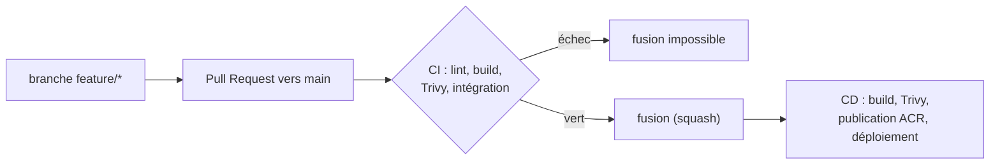

# CI/CD

Volet **CI/CD**. Les preuves sont dans [`preuves/J6/`](../../preuves/J6/).

## Parcours d'une modification



- On ne pousse jamais directement sur `main` : un ruleset l'interdit, administrateur compris.
- Une PR n'est fusionnable que si tous les contrôles requis sont verts. `gh pr merge --squash --auto` fusionne d'elle-même dès qu'ils le sont.
- Une PR ne publie aucune image et ne se connecte pas à Azure. La publication et le déploiement n'ont lieu qu'après fusion.

## CI : `.github/workflows/ci.yml`

Déclenchée sur chaque PR vers `main`.

| Contrôle (nom exact) | Ce qu'il vérifie | Échoue si |
| --- | --- | --- |
| `Lint et configuration` | hadolint (Dockerfiles), shellcheck (scripts), actionlint (workflows), `docker compose config`, Trivy en mode configuration et secrets | Un avertissement, une mauvaise configuration ou un secret dans le dépôt |
| `Image frontend (build et Trivy)` | Construction, puis scan Trivy de l'image construite | Une vulnérabilité CRITICAL (même sans correctif), ou une HIGH qui a un correctif |
| `Image backend (build et Trivy)` | Idem | Idem |
| `Image db (build et Trivy)` | Idem | Idem |
| `Intégration (Compose)` | La pile complète démarre avec les images scannées, puis `scripts/smoke-test.sh` | Un service ne devient pas sain, ou le parcours inscription → Résultat → lecture administrateur échoue |
| `Terraform (fmt, validate, tflint)` | Formatage, validation et règles tflint (générales et Azure) du code `infra/terraform` | Code mal formaté, invalide, ou règle tflint enfreinte |

### Règles du workflow

- **Moindre privilège.** `permissions: contents: read` par défaut. Seuls les jobs d'image ont `security-events: write`, pour publier le rapport Trivy (SARIF) dans l'onglet Security du dépôt.
- **Actions épinglées par SHA de commit**, avec le tag en commentaire : un tag peut être déplacé vers du code malveillant, un SHA non. Dependabot propose les mises à jour.
- **`persist-credentials: false`** sur chaque checkout : le jeton du workflow ne reste pas dans `.git/config`, où une étape suivante pourrait le lire.
- **Aucun `continue-on-error`** : un contrôle qui échoue fait échouer le job.
- **Annulation des passages obsolètes** (`concurrency`) : un nouveau push sur la PR annule le passage précédent.

### Cache

Chaque image a son propre cache dans le cache GitHub Actions (`type=gha,scope=<image>`, `mode=max` pour garder aussi les couches des étapes de construction). Le job d'intégration reconstruit depuis ce cache : toutes les couches sont reprises, ce sont donc les images qui viennent d'être scannées, sans transfert d'archive entre jobs.

Le cache GitHub Actions est limité à 10 Go par dépôt et efface les entrées inutilisées depuis 7 jours ; au pire, un build repart de zéro.

## Protection de `main`

Ruleset actif sur la branche par défaut, **sans aucune exception de contournement**, administrateur compris :

| Règle | Effet |
| --- | --- |
| Pull request obligatoire | Aucun push direct sur `main` |
| Contrôles requis | Les 6 contrôles ci-dessus (le sixième, Terraform, depuis la PR #16), avec leurs noms relevés sur le premier passage réel ; la branche doit être à jour avec `main` |
| Pas de suppression, pas de force push | L'historique de `main` ne peut pas être réécrit |
| Historique linéaire | Fusion par squash uniquement : un commit par PR |

**Limite assumée : 0 approbation requise sur les PR.** Le dépôt n'a qu'un contributeur, et GitHub interdit à l'auteur d'une PR de l'approuver. Exiger une approbation bloquerait toute fusion. Le sujet le prévoit : la règle n'est activée que si un autre membre a les droits, et sinon elle est documentée plutôt que prétendue active. Avec un second membre, il suffit de passer `required_approving_review_count` à 1.

**Mesure compensatoire : approbation obligatoire avant tout déploiement.** L'environnement GitHub `production` exige l'approbation d'un relecteur désigné. Rien n'est publié dans le registre ni déployé tant qu'elle n'est pas donnée, et le job reste en attente. L'auto-approbation est autorisée (`prevent_self_review: false`), seul moyen d'approuver avec un unique contributeur ; chaque approbation reste tracée dans l'historique des déploiements.

## Sécurité du dépôt

| Fonction GitHub | État |
| --- | --- |
| Secret scanning et protection au push | Activés : un push contenant un secret reconnu est refusé |
| Alertes Dependabot et correctifs de sécurité automatiques | Activés |
| Dependabot (versions) | Hebdomadaire : actions, images de base, paquets npm ; versions majeures exclues pour les images et npm |
| Rapports Trivy | Onglet Security, une catégorie par image |

## CD : `.github/workflows/cd.yml`

Déclenché à chaque push sur `main`, donc à chaque fusion, sauf quand seuls la documentation ou les preuves changent (`docs/**`, `preuves/**`, `*.md`) : les images seraient identiques. Un seul job, `Publier et déployer`, dans l'environnement `production` :

| Étape | Rôle |
| --- | --- |
| Attente d'approbation | L'environnement `production` exige une approbation explicite et n'accepte que `main` |
| Build et Trivy | Les deux images sont reconstruites (depuis le cache) et rescannées avec les règles de la CI. La fusion par squash crée un nouveau commit : l'image publiée n'est pas celle que la PR a scannée, d'où ce second scan |
| Connexion OIDC | `azure/login` échange un jeton GitHub de courte durée contre un accès de l'identité `id-quiz-github` |
| Publication | Images taguées par le SHA du commit de fusion, avec SBOM et provenance |
| Déploiement | `az containerapp update --image` sur le backend, puis le frontend : une nouvelle révision chacun |
| Vérification | Les nouvelles révisions doivent être prêtes et `/health` doit répondre 200 ; révisions avant et après dans le résumé du job |

### Pourquoi OIDC

Aucun mot de passe Azure n'est stocké dans GitHub. L'identité `id-quiz-github` fait confiance aux jetons émis par GitHub pour un sujet exact :

```text
repo:Stephane-Dedu@105072484/eval-quiz-app@1472861267:environment:production
```

- **Les identifiants immuables du compte et du dépôt font partie du sujet** (option `use_immutable_subject` de GitHub). Si le dépôt était renommé, ou supprimé puis recréé sous le même nom, le nouveau dépôt n'obtiendrait pas cette confiance.
- **Seul l'environnement `production` est accepté.** Un workflow d'un autre dépôt, d'une autre branche ou d'un autre environnement ne peut pas se servir de l'identité.
- **Ce format a été constaté au premier passage du CD.** L'identifiant fédéré, créé avec le format classique `repo:<compte>/<dépôt>:…`, a été refusé (`AADSTS700213: No matching federated identity record found`). Le sujet réellement présenté a été relevé dans le journal, puis vérifié par l'API GitHub (`actions/oidc/customization/sub`).

| Valeur dans GitHub | Nature |
| --- | --- |
| `AZURE_CLIENT_ID`, `AZURE_TENANT_ID`, `AZURE_SUBSCRIPTION_ID` | Variables de l'environnement `production` : identifiants publics, pas des secrets |
| Secrets | Aucun (`gh secret list` est vide) |

L'identité ne peut que pousser dans le registre et créer des révisions des applications du groupe de ressources. Les secrets de l'application restent dans Container Apps ([ADR 0004](../adr/0004-cd-sans-secret-applicatif.md)).

### Cache entre CI et CD

Le cache GitHub Actions est cloisonné par branche : une PR lit le cache de `main`, mais `main` ne lit pas celui des PR. Le premier passage du CD reconstruit donc à froid. Il écrit ensuite son cache sur `main`, que les PR suivantes réutilisent.
