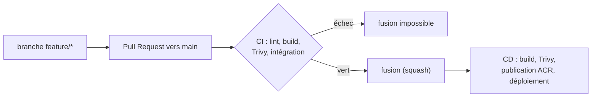

# CI/CD

Volet **CI/CD**. Les preuves sont dans [`preuves/J6/`](../../preuves/J6/).

## Parcours d'une modification

- On ne pousse jamais directement sur `main` : un ruleset l'interdit, administrateur compris.
- Une PR n'est fusionnable que si tous les contrôles requis sont verts. `gh pr merge --squash --auto` fusionne d'elle-même dès qu'ils le sont.
- Une PR ne publie aucune image et ne se connecte pas à Azure. La publication et le déploiement n'ont lieu qu'après fusion.

## CI : `.github/workflows/ci.yml`

Déclenchée sur chaque PR vers `main`.

| Contrôle (nom exact) | Ce qu'il vérifie | Échoue si |
| --- | --- | --- |
| `Lint et configuration` | hadolint (Dockerfiles), shellcheck (scripts), actionlint (workflows), `docker compose config`, Trivy en mode configuration et secrets | Un avertissement, une mauvaise configuration ou un secret dans le dépôt |
| `Image frontend (build et Trivy)` | Construction, puis scan Trivy de l'image construite | Une vulnérabilité CRITICAL (même sans correctif), ou une HIGH qui a un correctif |
| `Image backend (build et Trivy)` | Idem | Idem |
| `Image db (build et Trivy)` | Idem | Idem |
| `Intégration (Compose)` | La pile complète démarre avec les images scannées, puis `scripts/smoke-test.sh` | Un service ne devient pas sain, ou le parcours inscription → Résultat → lecture administrateur échoue |

### Règles du workflow

- **Moindre privilège.** `permissions: contents: read` par défaut. Seuls les jobs d'image ont `security-events: write`, pour publier le rapport Trivy (SARIF) dans l'onglet Security du dépôt.
- **Actions épinglées par SHA de commit**, avec le tag en commentaire : un tag peut être déplacé vers du code malveillant, un SHA non. Dependabot propose les mises à jour.
- **`persist-credentials: false`** sur chaque checkout : le jeton du workflow ne reste pas dans `.git/config`, où une étape suivante pourrait le lire.
- **Aucun `continue-on-error`** : un contrôle qui échoue fait échouer le job.
- **Annulation des passages obsolètes** (`concurrency`) : un nouveau push sur la PR annule le passage précédent.

### Cache

Chaque image a son propre cache dans le cache GitHub Actions (`type=gha,scope=<image>`, `mode=max` pour garder aussi les couches des étapes de construction). Le job d'intégration reconstruit depuis ce cache : toutes les couches sont reprises, ce sont donc les images qui viennent d'être scannées, sans transfert d'archive entre jobs.

Le cache GitHub Actions est limité à 10 Go par dépôt et efface les entrées inutilisées depuis 7 jours ; au pire, un build repart de zéro.

## Protection de `main`

Ruleset actif sur la branche par défaut, **sans aucune exception de contournement**, administrateur compris :

| Règle | Effet |
| --- | --- |
| Pull request obligatoire | Aucun push direct sur `main` |
| Contrôles requis | Les 5 contrôles ci-dessus, avec leurs noms relevés sur le premier passage réel ; la branche doit être à jour avec `main` |
| Pas de suppression, pas de force push | L'historique de `main` ne peut pas être réécrit |
| Historique linéaire | Fusion par squash uniquement : un commit par PR |

**Limite assumée : 0 approbation requise.** Le dépôt n'a qu'un contributeur, et GitHub interdit à l'auteur d'une PR de l'approuver. Exiger une approbation bloquerait toute fusion. Le sujet le prévoit : la règle n'est activée que si un autre membre a les droits, et sinon elle est documentée plutôt que prétendue active. Avec un second membre, il suffit de passer `required_approving_review_count` à 1.

## Sécurité du dépôt

| Fonction GitHub | État |
| --- | --- |
| Secret scanning et protection au push | Activés : un push contenant un secret reconnu est refusé |
| Alertes Dependabot et correctifs de sécurité automatiques | Activés |
| Dependabot (versions) | Hebdomadaire : actions, images de base, paquets npm ; versions majeures exclues pour les images et npm |
| Rapports Trivy | Onglet Security, une catégorie par image |
