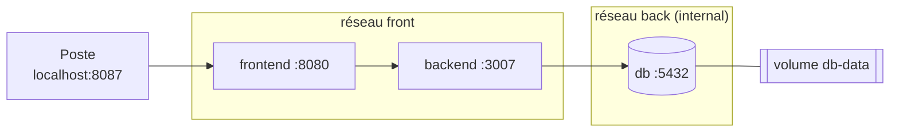

# Conteneurisation : images et Docker Compose

Volets **Dockerfile**, **Conteneurs** et **Compose**. Les preuves sont dans [`preuves/J1/`](../../preuves/J1/) et [`preuves/J2/`](../../preuves/J2/).

## Lancer l'application en local

Prérequis : Docker avec Compose v2.

```console
$ cp .env.example .env
$ docker compose up -d --build --wait
$ ./scripts/smoke-test.sh
```

| URL | Page |
| --- | --- |
| http://localhost:8087 | Quiz |
| http://localhost:8087/gestion-quiz | Administration (identifiants `ADMIN_USERNAME` / `ADMIN_PASSWORD` du `.env`) |

| Commande | Effet |
| --- | --- |
| `docker compose logs -f backend` | Suivre les journaux d'un service |
| `docker compose down` | Arrêter et supprimer les conteneurs ; **les données restent** dans le volume |
| `docker compose down -v` | Tout supprimer, données comprises ; le schéma sera rejoué au prochain démarrage |
| `./scripts/captures.sh <dossier>` | Rejouer le parcours complet dans un navigateur et en prendre des captures |

## Trois images, trois Dockerfiles

| Image | Dockerfile | Base | Utilisateur | Port |
| --- | --- | --- | --- | --- |
| frontend | `Dockerfile` | `node:26` Alpine pour construire, `nginx-unprivileged` Alpine pour servir | 101 | 8080 |
| backend | `backend/Dockerfile` | `node:26` Alpine | 1000 | 3007 |
| base (local uniquement) | `database/Dockerfile` | `postgres:18.7` Alpine | 70 | 5432 |

Principes communs, avec la commande qui les vérifie dans [la liste de contrôle](checklists.md) :

- **Multi-étapes.** On construit avec les outils, on n'exécute qu'avec le résultat. Le frontend n'embarque que les fichiers statiques produits par Vite ; le backend, que ses dépendances de production et `server.js`.
- **Images de base épinglées par digest.** `node:26.13.1-alpine3.24@sha256:…` désigne une image précise et immuable, alors qu'un tag peut être republié. Le digest est celui de l'index multi-architecture : la même ligne fonctionne en arm64 (poste) et en amd64 (CI, Azure). Dependabot propose les mises à jour.
- **Ordre des couches.** Ce qui change rarement d'abord (lockfile, `npm ci`), ce qui change souvent ensuite (code, puis fichiers de **Questions**). Modifier une **Question** ne reconstruit pas les dépendances.
- **Cache npm monté** (`RUN --mount=type=cache`) : même quand le lockfile change, les paquets déjà téléchargés ne le sont pas une seconde fois.
- **`.dockerignore` en liste blanche.** Tout est exclu sauf les fichiers nommés : un `.env`, une preuve ou un nouveau dossier n'entre jamais par accident dans une image.
- **Non-root, avec un uid numérique.** Un uid numérique permet à la plateforme de vérifier qu'il n'est pas 0 sans lire `/etc/passwd`.
- **`apk upgrade` à la construction.** Il applique les correctifs Alpine parus depuis la publication de l'image de base. Contrepartie : deux constructions à des dates différentes peuvent différer. C'est pourquoi chaque image est tracée par le SHA du commit et scannée avant publication.
- **Contrôle de santé dans l'image** (`HEALTHCHECK`) : Compose l'utilise pour ordonner les démarrages. Azure Container Apps l'ignore et utilise ses propres sondes.

Particularités :

- **Frontend.** Nginx génère sa configuration au démarrage depuis `nginx/default.conf.template`, en y remplaçant `${BACKEND_ORIGIN}`. La même image sert donc en local (`http://backend:3007`) et sur Azure (`http://ca-quiz-backend`).
- **Backend.**
  - tini est le processus 1 et transmet les signaux à Node. Sans lui, Node en processus 1 ignore SIGTERM et `docker stop` attend 10 secondes avant de tuer le conteneur.
  - npm est retiré de l'image finale, avec les vulnérabilités de ses dépendances embarquées.
- **Base.**
  - `init.sql` est intégré à l'image et n'est exécuté qu'à la création d'un volume vide.
  - Le conteneur démarre directement en utilisateur `postgres`, ce qui rend `gosu` inutile ; il est retiré avec les vulnérabilités de son binaire Go.

## Docker Compose



| Choix | Raison |
| --- | --- |
| Deux réseaux, `back` interne | Le frontend ne peut pas joindre la base ; la base n'a aucun accès sortant ni port publié |
| Seul le frontend publie un port | Une seule porte d'entrée, comme sur Azure |
| `depends_on` avec `condition: service_healthy` | Le backend attend que la base accepte les connexions (sinon la première inscription échoue) ; le frontend attend le backend (Nginx résout son nom au démarrage) |
| `read_only`, `cap_drop: [ALL]`, `no-new-privileges` | Un processus compromis ne peut ni modifier l'image, ni gagner de privilèges ; les seuls emplacements inscriptibles sont des `tmpfs` et le volume |
| Limites CPU et mémoire | Un service emballé ne peut pas affamer les autres |
| `${VARIABLE:?…}` pour chaque valeur sensible | Compose refuse de démarrer si une valeur manque, au lieu de laisser le backend utiliser ses valeurs par défaut faibles (`admin123`, `change-this-secret`) |
| `image: ${FRONTEND_IMAGE:-…}` | La CI réutilise les images qu'elle vient de construire et de scanner, sans les reconstruire |
| Aucun secret dans le fichier | Toutes les valeurs viennent de `.env`, ignoré par git |

## Nginx

- **Politique de sécurité du contenu stricte.** Tout vient de la même origine : aucun script, style ou appel externe, aucun script ni style en ligne. Les captures automatisées échouent si le navigateur bloque quoi que ce soit.
- **Autres en-têtes :** `X-Content-Type-Options`, `X-Frame-Options`, `Referrer-Policy`, `Permissions-Policy`, `Cross-Origin-Opener-Policy`, HSTS (effectif en HTTPS sur Azure).
  - Ils sont dans `nginx/security-headers.conf`, inclus dans chaque `location`. Nginx n'hérite pas des `add_header` d'un niveau supérieur dès qu'une `location` en déclare un.
- **Cache :**
  - `/assets/` est en cache un an (`immutable`), puisque le nom de fichier change avec son contenu.
  - Les pages HTML sont toujours revalidées (`no-cache`).
- **Compression gzip** des fichiers texte.
- **Versions masquées :** ni la version de Nginx ni l'en-tête `X-Powered-By` d'Express ne sont exposés.

## Problèmes fréquents

| Symptôme | Cause | Solution |
| --- | --- | --- |
| `required variable … is missing a value` | `.env` absent ou incomplet | `cp .env.example .env` |
| Le test d'intégration échoue en 429 | Plus de 5 inscriptions en 15 minutes depuis la même IP (limiteur du backend) | Attendre la fin de la fenêtre, ou `docker compose restart backend` (compteurs en mémoire) |
| Port 8087 déjà utilisé | Autre service local | `FRONTEND_PORT=8088` dans `.env` |
| Nouvelle **Question** absente après `up` | Image non reconstruite | `docker compose up -d --build` |
| Données « perdues » | `down -v` supprime le volume | Utiliser `down` sans `-v` |
