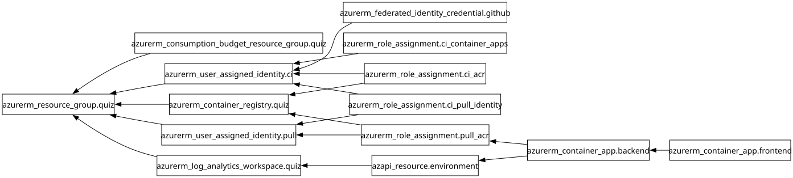

# Vitrine Terraform

Les mêmes ressources que [`scripts/deploy.sh`](../../scripts/deploy.sh), décrites en Terraform, dans leur propre groupe (`rg-quiz-tf-gwc`) et avec des noms suffixés `-tf`. Le déploiement évalué reste celui d'Azure CLI, comme l'exige le sujet ([ADR 0001](../../docs/adr/0001-azure-cli-deploie-terraform-en-vitrine.md)).

| Fichier | Contenu |
| --- | --- |
| `versions.tf` | Versions de Terraform et des fournisseurs ; bloc d'état distant commenté |
| `variables.tf` | Paramètres, avec validations (secrets solides, TLS obligatoire) |
| `main.tf` | Ressources |
| `outputs.tf` | URL, registre, identifiant du CD |
| `.terraform.lock.hcl` | Empreintes des fournisseurs (macOS arm64 et Linux amd64) |
| `graphe.svg` | Graphe des dépendances, régénéré par `./graphe.sh` |



## Deux fournisseurs

- **`azurerm`** pour presque tout.
- **`azapi`** pour l'environnement Container Apps. Il faut le mode `WorkloadProfiles`, que ni Azure CLI ni `azurerm` ne permettent de choisir ; sans lui, l'environnement serait en mode Express, sans découverte de services ([ADR 0005](../../docs/adr/0005-environnement-workload-profiles.md)). `azapi` appelle directement l'API `2026-07-01`. La clé du workspace de journaux passe par `sensitive_body` : elle n'apparaît ni dans le plan ni dans l'état.

## Correspondance avec `deploy.sh`

| `deploy.sh` (Azure CLI) | Terraform |
| --- | --- |
| `az group create` | `azurerm_resource_group.quiz` |
| `az rest` (API Consumption, budget) | `azurerm_consumption_budget_resource_group.quiz` |
| `az monitor log-analytics workspace create` | `azurerm_log_analytics_workspace.quiz` |
| `az acr create --sku Basic --admin-enabled false` | `azurerm_container_registry.quiz` |
| `az identity create` (tirage, CD) | `azurerm_user_assigned_identity.pull`, `.ci` |
| `az role assignment create` × 4 | `azurerm_role_assignment.pull_acr`, `.ci_acr`, `.ci_container_apps`, `.ci_pull_identity` |
| `az identity federated-credential create` | `azurerm_federated_identity_credential.github` |
| `az rest --method put` (environnement WorkloadProfiles) | `azapi_resource.environment` |
| `az containerapp create` (backend, ingress interne) | `azurerm_container_app.backend` |
| `az containerapp create` (frontend, ingress externe) | `azurerm_container_app.frontend` |
| Construction, scan et publication des images | Hors Terraform : `docker buildx build --push` (étape 2 ci-dessous) |
| Schéma PostgreSQL (`psql`, une seule fois) | Hors Terraform : la base est externe (Neon) |

## Déployer, puis détruire

Azure for Students n'autorise qu'**un environnement Container Apps par abonnement** : la vitrine ne peut tourner que pendant que le déploiement évalué est détruit (`scripts/destroy.sh`).

Les applications ont besoin d'images dans le registre, et le registre est créé par Terraform : le déploiement se fait en deux `apply`.

```console
$ cp terraform.tfvars.example terraform.tfvars        # ignoré par git ; y mettre secrets et e-mail
$ terraform init

# 1. Socle : groupe, budget, journaux, registre, identités, droits, environnement
$ terraform apply

# 2. Images dans le registre de la vitrine, construites pour Azure (linux/amd64)
$ az acr login -n crquizsdedutf
$ TAG=$(git rev-parse HEAD)
$ docker buildx build --platform linux/amd64 -t crquizsdedutf.azurecr.io/quiz-backend:$TAG --push ../../backend
$ docker buildx build --platform linux/amd64 -t crquizsdedutf.azurecr.io/quiz-frontend:$TAG --push ../..

# 3. Applications
$ terraform apply -var deploy_apps=true -var image_tag=$TAG
$ curl -s "$(terraform output -raw frontend_url)/health"

# Destruction complète
$ terraform destroy -var deploy_apps=true -var image_tag=$TAG
```

## Contrôles en CI

Le job `Terraform (fmt, validate, tflint)` de la CI vérifie à chaque PR :
- le formatage (`terraform fmt -check`) ;
- la cohérence (`terraform validate`) ;
- les règles `tflint`, générales et propres à Azure.

Le scan Trivy en mode configuration, déjà présent dans le job `Lint et configuration`, couvre aussi ce dossier.
