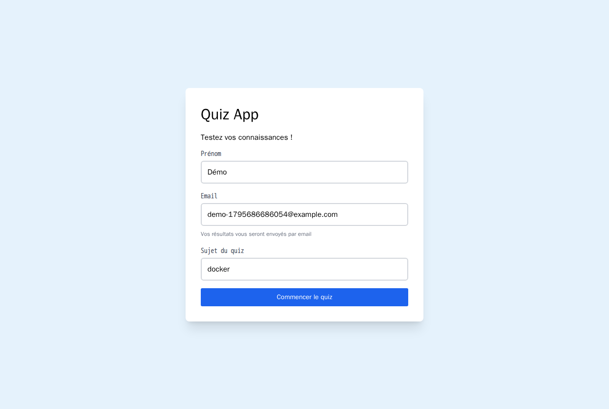
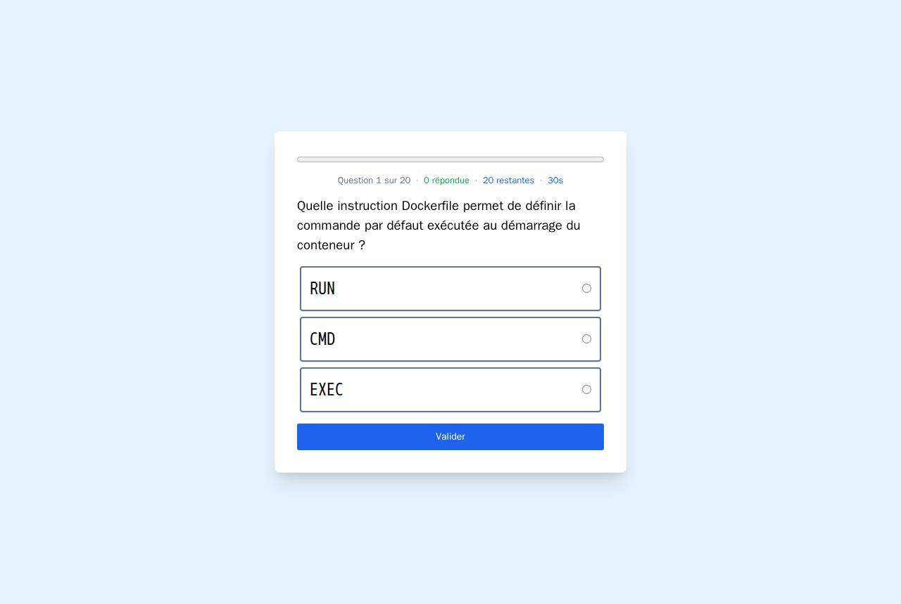
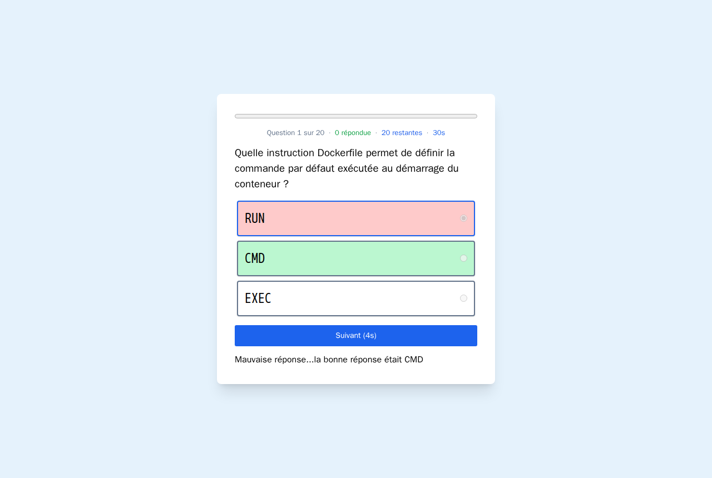
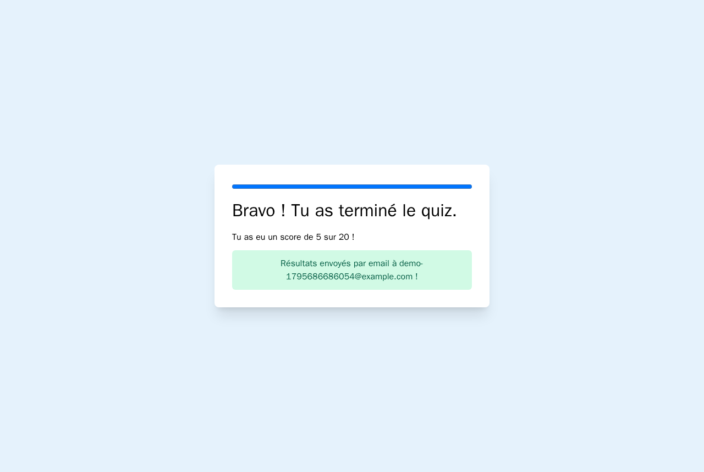
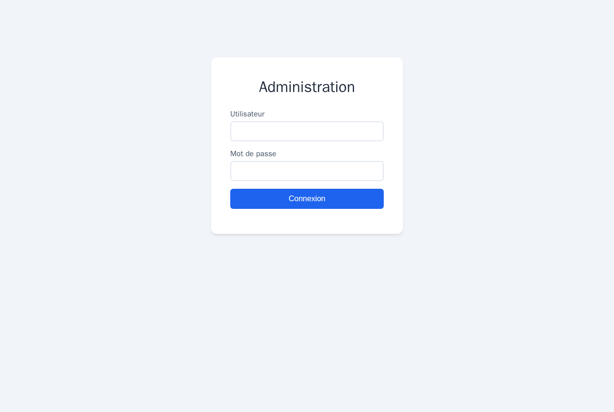
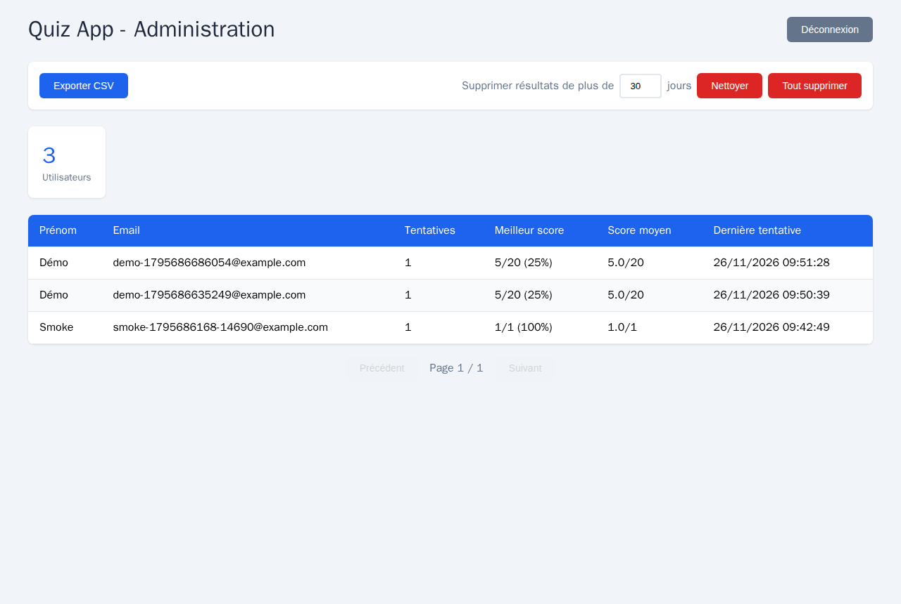

# J1 — Conteneurisation locale

**Date :** 2026-11-26
**Environnement :** Docker 29.9.3, Docker Compose 5.7.0, macOS (arm64)

| Preuve | Où |
| --- | --- |
| Analyse préalable (composants, ports, configuration, routes, persistance, schéma local) | [`docs/technique/analyse-j1.md`](../../docs/technique/analyse-j1.md) |
| Diagnostic : le backend démarre-t-il sans base ? | [`diagnostic-demarrage-backend.md`](diagnostic-demarrage-backend.md) |
| Dockerfiles, `docker-compose.yml`, `.env.example` | Racine du dépôt, `backend/`, `database/` |
| Parcours complet dans un navigateur | [Captures](#parcours-dans-le-navigateur) ci-dessous |

**Écart assumé :** `docs/03` demande de faire valider J1 par le formateur avant le déploiement cloud. Le groupe a déployé sur Azure le 2026-11-26 sans attendre cette validation. Les preuves J1 complètes étaient déjà dans le dépôt depuis la [PR #5](https://github.com/Stephane-Dedu/eval-quiz-app/pull/5), fusionnée avant le premier déploiement.

## Démarrage depuis un clone vierge

```console
$ cp .env.example .env
$ docker compose up -d --build --wait
 Container quiz-db-1 Healthy
 Container quiz-backend-1 Healthy
 Container quiz-frontend-1 Healthy

$ docker compose ps
SERVICE    IMAGE                 STATUS                   PORTS
backend    quiz-backend:local    Up 7 minutes (healthy)   3007/tcp
db         quiz-db:local         Up 7 minutes (healthy)   5432/tcp
frontend   quiz-frontend:local   Up 7 minutes (healthy)   0.0.0.0:8087->8080/tcp, [::]:8087->8080/tcp
```

Les trois services sont sains en 14 secondes. Seul le frontend publie un port (8087) ; le backend et la base n'exposent leur port qu'aux réseaux Docker.

## Frontend ↔ backend ↔ base : test d'intégration

`/health` seul ne prouve rien sur la base (voir le diagnostic). Le test inscrit un **Participant**, enregistre un **Résultat**, puis le relit côté **Administrateur** :

```console
$ ./scripts/smoke-test.sh
Test d'intégration sur http://localhost:8087

▶ Santé du backend, via le frontend
  ✓ GET /health (HTTP 200)
  ✓ corps {"status":"ok"}

▶ Pages servies par Nginx
  ✓ GET / (HTTP 200)
  ✓ GET /gestion-quiz (HTTP 200)

▶ En-têtes de sécurité
  ✓ CSP, nosniff, X-Frame-Options et Referrer-Policy présents

▶ Inscription d'un Participant
  ✓ POST /api/users (HTTP 201)
  ✓ Participant n°1

▶ Enregistrement d'un Résultat
  ✓ POST /api/results (HTTP 201)
  ✓ Résultat n°1

▶ Lecture côté Administrateur
  ✓ POST /api/admin/login (HTTP 200)
  ✓ GET /api/admin/results (HTTP 200)
  ✓ le Résultat de smoke-1795686168-14690@example.com est relu depuis PostgreSQL

✅ Frontend, backend et base communiquent.
```

## Persistance après recréation des conteneurs

```console
$ docker compose down            # sans -v : le volume est conservé
Container quiz-frontend-1 Removed 
Container quiz-backend-1 Removed 
Container quiz-db-1 Removed 
Network quiz_front Removing 
Network quiz_back Removing 
Network quiz_back Removed 
Network quiz_front Removed 

$ docker volume ls --filter name=quiz_db-data
quiz_db-data

$ docker compose up -d --wait
Container quiz-db-1 Healthy 
Container quiz-backend-1 Healthy 
Container quiz-backend-1 Healthy 
Container quiz-db-1 Healthy 
Container quiz-frontend-1 Healthy 

$ docker compose logs db | grep -iE "skipping|01-schema"
PostgreSQL Database directory appears to contain a database; Skipping initialization

$ docker compose exec db psql -U quiz_user -d quiz_db -c "SELECT u.email, r.score, r.total_questions FROM users u JOIN quiz_results r ON r.user_id = u.id"
               email                | score | total_questions 
------------------------------------+-------+-----------------
 smoke-1795686168-14690@example.com |     1 |               1
(1 row)

```

Le volume nommé `quiz_db-data` survit à `docker compose down`. Au redémarrage, PostgreSQL trouve une base existante et **n'exécute pas** `init.sql`, qui n'est pas rejouable. Seul `docker compose down -v` efface les données.

## Isolation réseau

```console
$ docker compose exec frontend nc -z -w 2 db 5432        # frontend → base
nc: bad address 'db'
code de sortie : 1

$ docker compose exec backend nc -z -w 2 db 5432         # backend → base
code de sortie : 0

$ docker inspect quiz-db-1 --format "{{json .NetworkSettings.Ports}}"   # poste → base
{"5432/tcp":null}

$ docker compose exec db wget -q -T 3 -O /dev/null http://example.com   # base → Internet
wget: bad address 'example.com'
code de sortie : 1

$ docker compose exec backend nc -z -w 3 api.resend.com 443   # backend → Internet (Resend)
code de sortie : 0
```

| Depuis → vers | Résultat | Pourquoi |
| --- | --- | --- |
| frontend → base | refusé (nom `db` inconnu) | Le frontend n'est pas sur le réseau `back` |
| backend → base | autorisé | Le backend est le seul service sur les deux réseaux |
| poste → base | aucun port publié | `5432/tcp` n'a pas de liaison sur l'hôte |
| base → Internet | refusé | Le réseau `back` est `internal: true` |
| backend → Resend | autorisé | Le réseau `front` garde l'accès sortant |

Le poste de test fait tourner un PostgreSQL natif sur `localhost:5432`, sans rapport avec le projet : ne pas publier le port de la base évite aussi ce conflit.

## Durcissement à l'exécution

Chaque service tourne avec un système de fichiers en lecture seule (`read_only: true`), sans capacité Linux (`cap_drop: [ALL]`), sans élévation de privilèges (`no-new-privileges`) et avec des limites de ressources. Les seuls emplacements inscriptibles sont des `tmpfs` (sockets et configuration générée) et le volume de la base.

```console
$ docker stats --no-stream
NAME              CPU %     MEM USAGE / LIMIT
quiz-backend-1    0.08%     33.14MiB / 256MiB
quiz-db-1         0.00%     33.61MiB / 512MiB
quiz-frontend-1   0.00%     10.57MiB / 128MiB
```

Arrêt de chaque service (`docker compose stop <service>`) : frontend 0,42 s, backend 0,27 s, base 0,25 s.

## En-têtes HTTP

```console
$ curl -sI http://localhost:8087/
HTTP/1.1 200 OK
Server: nginx
Content-Security-Policy: default-src 'self'; script-src 'self'; style-src 'self'; img-src 'self' data:; font-src 'self'; connect-src 'self'; object-src 'none'; base-uri 'self'; form-action 'self'; frame-ancestors 'none'
X-Content-Type-Options: nosniff
X-Frame-Options: DENY
Referrer-Policy: strict-origin-when-cross-origin
Permissions-Policy: camera=(), microphone=(), geolocation=(), payment=()
Cross-Origin-Opener-Policy: same-origin
Strict-Transport-Security: max-age=31536000
Cache-Control: no-cache

$ curl -sI -H 'Accept-Encoding: gzip' http://localhost:8087/assets/main-DkJUx5WR.js
HTTP/1.1 200 OK
Content-Security-Policy: default-src 'self'; script-src 'self'; style-src 'self'; img-src 'self' data:; font-src 'self'; connect-src 'self'; object-src 'none'; base-uri 'self'; form-action 'self'; frame-ancestors 'none'
Cache-Control: public, max-age=31536000, immutable
Content-Encoding: gzip

$ curl -s -D - -o /dev/null -X POST http://localhost:8087/api/admin/login   # en-têtes de l API
HTTP/1.1 401 Unauthorized
Server: nginx
RateLimit-Policy: 100;w=900
RateLimit-Limit: 100
RateLimit-Remaining: 99
RateLimit-Reset: 900
Content-Security-Policy: default-src 'self'; script-src 'self'; style-src 'self'; img-src 'self' data:; font-src 'self'; connect-src 'self'; object-src 'none'; base-uri 'self'; form-action 'self'; frame-ancestors 'none'
```

- Politique de sécurité du contenu stricte : tout vient de la même origine, sans script ni style en ligne.
- Fichiers hachés par Vite en cache un an et compressés ; pages HTML toujours revalidées, pour qu'une **Question** modifiée soit visible dès le déploiement.
- Ni la version de Nginx ni `X-Powered-By: Express` ne sont exposées.

## Parcours dans le navigateur

Captures prises par `./scripts/captures.sh preuves/J1/captures` : Playwright dans un conteneur remplit l'inscription, répond aux 20 **Questions** du **Sujet** docker, puis se connecte à l'administration. Le script échoue si la console du navigateur affiche la moindre erreur, par exemple une ressource bloquée par la politique de sécurité : [`console.txt`](captures/console.txt) est vide.

| Étape | Capture |
| --- | --- |
| Inscription |  |
| Question |  |
| Correction |  |
| Résultat enregistré |  |
| Connexion administrateur |  |
| Résultats en base |  |
